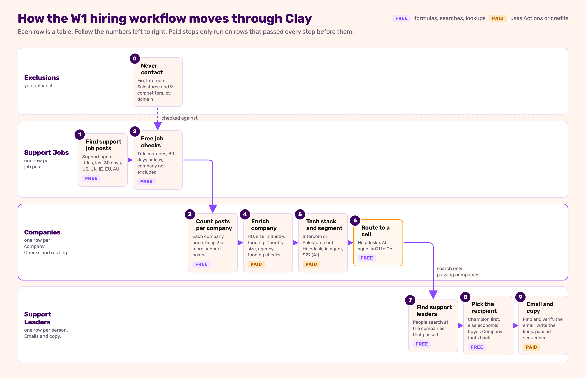

# Clay Build Guide: Hiring support agents in bulk (Fin, W1)

A step-by-step guide to building `workflow-spec.md` (in this folder) in Clay. Written for someone who has never built anything in Clay. Follow the parts in order. Each step tells you **why** it exists, **what to click**, **what to type**, **how to check it worked** and **what it costs**.

> **Don't skip the checks.** The most common Clay mistake is running a column on hundreds of rows before checking it worked on 1. Every step below ends with a check. If the check fails, fix it before moving on.

---

## Contents

- [What you are building](#what-you-are-building)
- [Clay words you need](#clay-words-you-need)
- [Before you start](#before-you-start)
- [Part 0. Set up the workbook](#part-0-set-up-the-workbook)
- [Part 1. Exclusions table](#part-1-exclusions-table)
- [Part 2. Find support job posts](#part-2-find-support-job-posts)
- [Part 3. Free checks on each job post](#part-3-free-checks-on-each-job-post)
- [Part 4. Companies table: count the posts](#part-4-companies-table-count-the-posts)
- [Part 5. Company checks](#part-5-company-checks)
- [Part 6. Tech stack, segment and routing](#part-6-tech-stack-segment-and-routing)
- [Part 7. Find the support leaders](#part-7-find-the-support-leaders)
- [Part 8. Pick the recipient](#part-8-pick-the-recipient)
- [Part 9. Find and verify the work email](#part-9-find-and-verify-the-work-email)
- [Part 10. Write the email lines](#part-10-write-the-email-lines)
- [Part 11. Views for the operator](#part-11-views-for-the-operator)
- [Part 12. Connect the sequencer (build it, don't launch it)](#part-12-connect-the-sequencer)
- [What it costs](#what-it-costs)
- [Final checklist](#final-checklist)
- [When something goes wrong](#when-something-goes-wrong)
- [Things the spec needs to fix](#things-the-spec-needs-to-fix)

---

## What you are building

The spec says: find **self-serve B2B SaaS companies (segment S2) that have posted 3 or more customer support agent jobs in the last 30 days**, check each company fits (region, size, funding, not an agency, not already on Intercom or Salesforce), sort each one into one of **6 cells** (which helpdesk they run x whether they already have an AI agent), find the support leader there, and send them a 3-email sequence whose Email 1 changes by cell.

You will build **4 tables** inside **1 workbook**:



Each row of the picture is a table. The numbers are the order you build in. Step 0 is the list you upload first.

Why this shape:
- **Signal first.** The trigger is a dated company event (job posts), so the build starts from job posts, not from people. One company can have 10 posts, so the posts are counted per company before anything else happens.
- **Company checks happen once per company**, in the Companies table. That's also where the cell is decided, because both routers (helpdesk, AI agent) are facts about the company.
- **People come last.** You only search for support leaders at companies that already passed every company check, so you never pay for emails at a company you can't send to.

What a finished row in **Companies** looks like, reading left to right:

| Company | Domain | Open support roles | Example role | HQ | Size | Funding | Agency? | Intercom or SF? | Segment | Helpdesk | AI agent? | Cell |
|---|---|---|---|---|---|---|---|---|---|---|---|---|
| Acme | acme.com | 4 | Customer Support Specialist | US | 201-500 | Pass | false | false | S2 | zendesk | false | C1 |

("Acme" is a made-up name to show the shape.)

And in **Support Leaders**:

| Person | Title | Persona | Recipient? | Cell | Ready to Contact? | Work Email | E1 L1 | E1 Block |
|---|---|---|---|---|---|---|---|---|
| Sam T. | Head of Customer Support | champion | true | C1 | true | sam@acme.com | Acme is hiring for several support roles right now, including a Customer Support Specialist. | Lightspeed runs Fin, an AI agent, on Zendesk… |

---

## Clay words you need

| Word | What it means |
|---|---|
| **Workbook** | A folder of tables for one campaign. |
| **Table** | A spreadsheet. One row per job post, per company or per person. |
| **Source** | Where a table's rows come from (a Clay search, a CSV, another table). |
| **Column** | One piece of information per row. Three kinds matter: **plain** (you type or import it), **formula** (Clay calculates it, free), **enrichment / action** (Clay calls a data provider or AI, usually costs). |
| **Formula** | A small calculation, like a spreadsheet formula. Free. Clay has an AI helper: describe what you want in plain English and it writes the formula for you. |
| **Enrichment** | A column that looks something up (company size, tech stack, an email). Costs **Actions**, and sometimes **Data Credits**. |
| **Use AI / Claygent** | An AI column. Use AI reads only the columns you give it. Claygent also browses websites, so it costs more: use it only as a backup. |
| **Lookup** | A column that reads matching rows from another table in your workbook. Free. "Single row" returns one match, "multiple rows" returns all of them. |
| **Send table data** | A column that copies rows from this table into another table. Free. |
| **Run condition** ("Only run if") | A rule on a paid column: it only runs on rows where the rule is true. This is how you avoid paying for rows you'll throw away. |
| **Auto-run** | When on, columns run on every new row by themselves. **Keep it off** while building. |
| **Actions** | Clay's main usage meter. About 1 Action per enrichment per row. Unused Actions expire monthly. |
| **Data Credits** | A second meter, used when Clay pays a data provider or AI model for you. |
| **View** | A saved filter on a table, like "only rows ready to send". |
| **Waterfall** | An email finder that tries providers in order and stops at the first verified email. |
| **Sandbox mode** | A Clay test mode that returns sample data (for example `jane.doe@clay.com`). **Make sure it's off** before you trust any result. |

---

## Before you start

- [ ] **Clay account** with enough Actions and Data Credits. See [What it costs](#what-it-costs).
- [ ] **Sandbox mode is off** (top right of any table).
- [ ] **The spec is open** next to you: `output/campaigns/hiring-support-agents-in-bulk/workflow-spec.md`. Sections 2 (who's in and out), 4 (signals), 5 (cells) and the Copy section are what you're building.
- [ ] **The exclusions CSV** is ready: `exclusion-list-domains.csv` in this folder (12 domains). If you already uploaded it to Clay this week, reuse that table.
- [ ] **Decide the test size.** Import up to **200 job posts** first. Job posts are counted per company, so you need more rows than in a people-first build to find companies with 3 or more.

---

## Part 0. Set up the workbook

**Why:** one place for everything in this campaign, so anyone can find it and follow it.

1. In Clay's left menu, click **Tables & workbooks** → **+ New** → **Workbook**. (If you keep a client folder, create it inside: **+ New** → **Folder...** first.)
2. Name it: `Fin · W1 Hiring support agents (30 days)`.
3. Click **Overview** (bottom left) → **Workbook settings**, and paste this description: *"Signal: 3+ customer support agent job posts in the last 30 days at a self-serve B2B SaaS company (S2). Spec: intercom-gtm-os/output/campaigns/hiring-support-agents-in-bulk/workflow-spec.md. Cells C1 to C6. Built, not launched."*

**Check:** the workbook appears in Tables & workbooks with that name.
**Cost:** free.

---

## Part 1. Exclusions table

**Why:** spec section 2 (Exclude) says we never email Fin itself or its competitors. One table, checked by every other table, matched on **domain**.

1. In the workbook, click **+ Add** → **Import from CSV**.
2. Upload `exclusion-list-domains.csv` (columns `domain`, `company`, `reason`). Name the table `Exclusions`.
3. Open the `domain` column's menu → **Edit column** → **Data type** → **URL** → Save.

The 12 rows: fin.ai, intercom.com, salesforce.com, zendesk.com, hubspot.com, freshworks.com, decagon.ai, sierra.ai, ada.cx, kustomer.com, gorgias.com, forethought.ai.

> **Why domain and not name:** names clash and vary ("Fin" is also a word in thousands of company names). A domain belongs to one company. Domains are written plain: `zendesk.com`, no `https://`, no `www.`, no slash at the end.

> Suppression (spec section 2, last row: contacted in the last 90 days, open CRM opportunity, unsubscribed) has no list yet, because there is no CRM. Until there is, add every company you send to into this same table after each send.

**Check:** 12 rows, each with a domain.
**Cost:** free.

---

## Part 2. Find support job posts

**Why:** this is the trigger (spec section 1 and signal 1). We look for job posts first, then count them per company in Part 4.

### 2.1 Start a jobs search

1. Click **+ Add** at the bottom of the workbook → **Find jobs** (Clay may call it "Find jobs" or "Job postings").
2. You'll see filters on the left and a live preview on the right.

> **If your Clay has no jobs search:** use **Find companies** instead (filters from 2.2 for country, size and industry), save to a table, then add the enrichment **Find jobs at company** (it may be called "Company job openings"). That route costs per company searched, so check the price on the column first. The spec's other fallback is an Apify LinkedIn Jobs scraper, which needs its own setup.

### 2.2 Set the filters

| Filter | Set it to | Why |
|---|---|---|
| **Job title: include** | Customer Support Agent · Customer Support Specialist · Customer Support Representative · Customer Support Associate · Customer Support Advocate · Technical Support Engineer · Technical Support Specialist · Support Engineer · Customer Experience Associate · Customer Experience Specialist · Customer Care Agent · Customer Care Specialist · Help Desk | The roles in the spec's title pattern (signal 1). Part 3 re-checks every title with a formula, so a loose search is fine |
| **Posted date** | Last **30 days** | Spec section 7: only posts from the last 30 days. Older ones have no timing hook |
| **Job location / country** | United States, United Kingdom, Ireland, Australia, and the EU countries you want this run | Spec section 2: region. The real HQ check comes in Part 5 |
| **Company size** (if offered) | 11-50 and every bigger band | Spec floor is more than 15 staff, and there's no ceiling yet. The exact check is in Part 5 |
| **Company industry** (if offered) | Software Development · Technology, Information and Internet | This run targets S2 (self-serve B2B SaaS). The AI check in Part 6 is the real segment test, this only cuts noise |

### 2.3 Check the volume, then import

1. Read the **count** above the preview and write it down. This is the free volume check.
2. Set **Result limits** to **200** for the first test.
3. Click **Continue** → **Save to new table**. Name it `Support Jobs`.
4. Click the table name → **Edit table settings** → **Auto-run off**.

### 2.4 Add the hidden fields as columns

1. Click any cell in the first column (the search source). The cell details open on the right.
2. Find and **Add as column**, then rename:
   - the job title → `Job Title`
   - the posting date → `Posted Date`
   - the job's URL → `Job URL`
   - the company name → `Company`
   - the company domain → `Company Domain` (data type **URL**)
   - the company LinkedIn URL → `Company LinkedIn URL` (data type **URL**)
3. Table settings → **Deduplication** → **Auto-dedupe rows** on `Job URL`, **Keep oldest row**.

**Check:** open 3 job URLs. Are they real support-agent jobs, posted in the last 30 days, at a software company?
**Cost:** free if Clay's jobs search is free in your plan. Clay shows a price before importing if it isn't: read it.

---

## Part 3. Free checks on each job post

**Why:** throw out posts that don't count before anything else. All formulas, all free.

**How to add a formula column:** scroll to the right end of the table → **+ Add column** → **Formula**. Type the plain English into the box, type `/` to insert each column, click **Generate**, then compare what Clay wrote with the formula below. Set the data type (**Checkbox** for true or false, **Number** for numbers) and save. Below, columns are written `{{Column Name}}`.

> **Always add "ignore upper and lower case"** to the plain English of any text check. Without it, Clay's helper often writes a case-sensitive formula and every row comes back false.

| Column | Plain English | Formula |
|---|---|---|
| `Support Role?` (Checkbox) | True if [Job Title] matches the spec's support-agent pattern: customer or technical support agent, specialist, representative, associate, advocate or engineer; customer experience or customer care associate, agent or specialist; or help desk. Ignore upper and lower case. | `/((customer\|technical)?\s*support (agent\|specialist\|representative\|associate\|advocate\|engineer)\|customer (experience\|care) (associate\|agent\|specialist)\|help ?desk)/i.test({{Job Title}} \|\| "")` |
| `Days Since Posted` (Number) | Number of days from [Posted Date] to today. Blank if there is no date. | `{{Posted Date}} ? Math.floor((Date.now() - Date.parse(String({{Posted Date}}).slice(0, 10) + "T00:00:00Z")) / 86400000) : null` |

### 3.1 `Exclusion Match` (lookup)

1. **+ Add column** → **Add enrichment** → search **Lookup single row** → **Look up single row in other table** (By Clay, free).
2. **Table to Search:** `Exclusions`. **Target Column:** `domain` (pick it from the dropdown, don't type it). **Filter Operator:** Equals. **Row Value:** type `/` → `Company Domain`.
3. Save, then **Run column** → run the empty rows. Never choose Force run all.

### 3.2 `Job Counts?`

- **Plain English:** *"True if [Company Domain] is filled in, [Support Role?] is true, [Days Since Posted] is between 0 and 30, and [Exclusion Match] found no row."*
- **Formula:**
```javascript
!!{{Company Domain}} && {{Support Role?}} === true && {{Days Since Posted}} !== null && {{Days Since Posted}} >= 0 && {{Days Since Posted}} <= 30 && !({{Exclusion Match}}?.record)
```

**Check:** sort by `Job Counts?`. Open 3 false rows: each should have a reason (wrong title, too old, no domain, or an excluded company like zendesk.com). If a good post is false, fix the formula, not the row.
**Cost:** free.

---

## Part 4. Companies table: count the posts

**Why:** the trigger is "3 or more posts **at the same company domain**" (spec section 2, Trigger). That's a per-company count, so each company goes into its own table once.

### 4.1 Send each company across

1. In `Support Jobs`: **+ Add column** → **Add enrichment** → **Send table data** (By Clay, free).
2. **Destination** → **Create** → name it `Companies`.
3. Send these columns: `Company Domain`, `Company`, `Company LinkedIn URL`.
4. Tick **Add run condition** and type: *"Only run when [Job Counts?] is true."* Click **Generate**. Check the formula is the same as `{{Job Counts?}} === true` and that the Preview says **Will run** only on the rows you expect.
5. Save. Run on **1 row**, open `Companies` and check the company arrived with the right domain.
6. In `Companies`: table name → **Edit table settings** → **Auto-dedupe rows** on `Company Domain`, **Keep oldest row**, and **Auto-run off**.
7. Back in `Support Jobs`, run **Send to Companies** on the rest.

**Check:** `Companies` has far fewer rows than `Support Jobs`, and no domain appears twice.
**Cost:** free.

### 4.2 Count the posts (signal 1, 1a, 1b)

In `Companies`:

1. **+ Add column** → **Add enrichment** → **Look up multiple rows in other table** (free).
   **Table to Search:** `Support Jobs`. **Target Column:** `Company Domain`. **Filter Operator:** Equals. **Row Value:** `/` → `Company Domain`. Leave Limit at 100. Name it `Support Jobs Found`. Save and run.
2. Add these formulas:

| Column | Plain English | Formula |
|---|---|---|
| `Open Support Roles` (Number) | Number of rows in [Support Jobs Found] where Job Counts? is true | `(({{Support Jobs Found}}?.records \|\| []).filter(r => r && r["Job Counts?"] === true)).length` |
| `Trigger Fired?` (Checkbox) | True if [Open Support Roles] is 3 or more | `{{Open Support Roles}} >= 3` |
| `Hiring Scale` (Text) | "adding to the team" for 3 to 4, "growing the team fast" for 5 to 9, "a large hiring push" for 10 or more, blank below 3 | `{{Open Support Roles}} >= 10 ? "a large hiring push" : {{Open Support Roles}} >= 5 ? "growing the team fast" : {{Open Support Roles}} >= 3 ? "adding to the team" : ""` |

3. `Example Role Title` (signal 1b), as a long formula:

- **Plain English:** *"From [Support Jobs Found], take the Job Title of the most recent post where Job Counts? is true (smallest Days Since Posted). Remove anything after a dash, bar, comma or opening bracket (location and team suffixes), remove seniority words (Senior, Sr, Junior, Jr, Entry level) and a trailing level number (I, II, III, 1, 2, 3)."*
- **Formula:**
```javascript
((({{Support Jobs Found}}?.records || []).filter(r => r && r["Job Counts?"] === true).sort((a, b) => (a["Days Since Posted"] ?? 999) - (b["Days Since Posted"] ?? 999))[0] || {})["Job Title"] || "").split(/\s[-–|]\s|\s\(|,/)[0].replace(/\b(senior|junior|sr|jr|entry[- ]level)\b\.?/gi, "").replace(/\s+(I{1,3}|IV|[123])$/i, "").replace(/\s+/g, " ").trim()
```
- **Check:** "Sr. Customer Support Specialist - London (Hybrid)" becomes "Customer Support Specialist". This text goes into Email 1, so read 5 of them by eye.

> `Hiring Scale` isn't used by the approved copy (the copy says "several support roles"), but it's free and useful when reading the table. The raw count never goes into copy (facts.md).

**Check:** pick one company and count its rows in `Support Jobs` by hand. Does `Open Support Roles` match?
**Cost:** free.

---

## Part 5. Company checks

**Why:** spec section 2 (Include and Exclude). Every check that can throw a company out runs **before** the people search.

### 5.1 Enrich each company (first paid step)

1. **+ Add column** → **Add enrichment** → **Enrich company** (By Clay).
2. **Input:** `Company LinkedIn URL` (it matches more reliably than the domain).
3. **Run condition:** *"Only run when [Trigger Fired?] is true and [Company LinkedIn URL] is not empty."* Generate, then check it matches `{{Trigger Fired?}} === true && !!{{Company LinkedIn URL}}`. Save without running.
4. Run on **1 row**. Open the cell and compare it with the company's LinkedIn page: right country, right size?
5. From that cell, **Add as column** and rename: `HQ Country`, `Size Band`, `Employees`, `Industry`, `Description`, and the funding range (it may be called "Total funding amount range USD") → `Funding Range`.
6. Run on the rest.

**Cost:** about 1 Action per company, plus Data Credits (the PaidHR build-along saw 0.5 Data Credits a row). Only companies with 3+ posts run.

### 5.2 Company formulas (free)

| Column | Plain English | Formula |
|---|---|---|
| `Country OK?` (Checkbox) | True if [HQ Country] is US, GB, UK, IE, AU or an EU country code. Ignore upper and lower case. | `["US","GB","UK","IE","AU","AT","BE","BG","HR","CY","CZ","DK","EE","FI","FR","DE","GR","HU","IT","LV","LT","LU","MT","NL","PL","PT","RO","SK","SI","ES","SE"].includes(String({{HQ Country}} \|\| "").trim().toUpperCase())` |
| `Size OK?` (Checkbox) | True if [Size Band] is 51-200 employees or bigger, or if [Size Band] is 11-50 employees or empty and [Employees] is more than 15 | see below |
| `Agency?` (Checkbox) | True if [Industry] is Staffing and Recruiting or Outsourcing and Offshoring Consulting, or [Description] contains outsourc, BPO, staffing or contact center (or centre) services. Ignore upper and lower case. | `["Staffing and Recruiting","Outsourcing and Offshoring Consulting"].includes({{Industry}} \|\| "") \|\| /outsourc\|\bBPO\b\|staffing\|contact cent(er\|re) services/i.test({{Description}} \|\| "")` |
| `Funding Check` (Text) | "Review" if [Funding Range] is empty, says unknown, or has no amount. Otherwise read the first amount in it (K, M or B): "Pass" if it is $10M or more, "Fail" if less | see below |
| `Human Decision` (Text, plain column) | Typed by you. "Funding OK" after you confirm a Review company raised more than $10M, or "Drop" | (not a formula) |

`Size OK?`:
```javascript
["51-200 employees","201-500 employees","501-1,000 employees","501-1000 employees","1,001-5,000 employees","1001-5000 employees","5,001-10,000 employees","5001-10000 employees","10,001+ employees","10001+ employees"].includes({{Size Band}} || "") || ((({{Size Band}} || "") === "11-50 employees" || !{{Size Band}}) && Number({{Employees}}) > 15)
```

`Funding Check`:
```javascript
(!{{Funding Range}} || /unknown/i.test({{Funding Range}})) ? "Review" : (v => v === null ? "Review" : v >= 10000000 ? "Pass" : "Fail")((m => m ? Number(m[1]) * ({k: 1e3, m: 1e6, b: 1e9})[m[2].toLowerCase()] : null)(String({{Funding Range}}).match(/([\d.]+)\s*([kmb])/i)))
```

> **Why the size check reads the band first:** the Employees number counts people who list the company on LinkedIn, and it can be wrong in both directions. The 11-50 band straddles the spec's floor (more than 15), so only inside that band does the count decide.

> **Why "Review" exists:** in our test, 6 of 9 companies came back "Funding unknown". Bootstrapped and privately owned companies have no funding record. The spec's rule ("more than $10M") is there to keep out startup-program companies, so an unknown company isn't passed automatically and isn't dropped either: it waits in the **Funding review** view (Part 11) for you to check it (search "[company] raised" or its Crunchbase page) and type **Funding OK** or **Drop** in `Human Decision`.

`ICP Basics Pass?` (Checkbox):
- **Plain English:** *"True if [Trigger Fired?] is true, [Country OK?] is true, [Size OK?] is true, [Agency?] is not true, [Human Decision] is not Drop, and either [Funding Check] is Pass or [Human Decision] is Funding OK."*
- **Formula:**
```javascript
{{Trigger Fired?}} === true && {{Country OK?}} === true && {{Size OK?}} === true && {{Agency?}} !== true && {{Human Decision}} !== "Drop" && ({{Funding Check}} === "Pass" || {{Human Decision}} === "Funding OK")
```

> **Checkbox, not text.** If a true/false column is set to Text, its cells hold the word "false", which isn't the same as false, and every check that reads it fails. Keep `Agency?` and every other true/false column as **Checkbox**.

**Check:** pick 3 companies and confirm each value by eye against their LinkedIn page.
**Cost:** free.

---

## Part 6. Tech stack, segment and routing

**Why:** spec section 2 excludes companies already on Intercom or Salesforce Service Cloud, section 4 routes on the helpdesk and AI agent (signals 2 and 3), and this run only sends to S2.

### 6.1 Tech stack (paid)

1. **+ Add column** → **Add enrichment** → search **technolog** → pick the website technologies enrichment (Clay may call it **Enrich website technologies** or **Find technology stack**; the spec names BuiltWith).
2. **Input:** `Company Domain`.
3. **Run condition:** *"Only run when [ICP Basics Pass?] is true."* Check it matches `{{ICP Basics Pass?}} === true`.
4. Run on **1 row**. Open the cell: you should see a long list of technologies (our test companies had 120 to 480).
5. **Add as column** the list of technology names → `Technologies Found`.
6. Run on the rest.

**Cost:** about 1 per company (Clay shows the price on the column, bottom right). Only companies that passed Part 5 run.

### 6.2 Tech formulas (free)

| Column | Plain English | Formula |
|---|---|---|
| `Uses Intercom or SF?` (Checkbox) | True if [Technologies Found] contains Intercom, Salesforce Service Cloud or Salesforce Live Agent. Ignore upper and lower case. | `/intercom\|salesforce service cloud\|salesforce live agent/i.test(String({{Technologies Found}} \|\| ""))` |
| `Helpdesk Route` (Text) | "zendesk" if [Technologies Found] contains Zendesk; otherwise "hubspot" if it contains HubSpot Conversations or HubSpot Messages; otherwise "none_detected". Ignore upper and lower case. | `/zendesk/i.test(String({{Technologies Found}} \|\| "")) ? "zendesk" : /hubspot conversations\|hubspot messages/i.test(String({{Technologies Found}} \|\| "")) ? "hubspot" : "none_detected"` |
| `AI Agent Present?` (Checkbox) | True if [Technologies Found] contains Decagon. Ignore upper and lower case. | `/decagon/i.test(String({{Technologies Found}} \|\| ""))` |

> Spec signal 3 reads **only Decagon**. Ada and Sierra detection isn't verified, so they're not read. Freshdesk counts as `none_detected` for the same reason.

> **Expect many companies to use Intercom already.** In our 9-company test, 3 of the 4 software companies had Intercom on their site. They aren't lost: the spec says they're expansion, so they go to the **Existing Intercom users** view (Part 11) for the account team.

**Check:** open one `Technologies Found` cell and search it for "Intercom". If it's there, that row's `Uses Intercom or SF?` must be true.
**Cost:** free.

### 6.3 Segment (Use AI, then Claygent as a backup)

**Why AI:** "self-serve B2B SaaS with online signup or a free trial, and a public help center" is a judgement about what the company sells and how, not a LinkedIn label. A bank and a SaaS company can both say "Financial Services".

#### 6.3a `Segment (AI)`: Use AI

1. **+ Add column** → **Use AI**. Open **Configure**. Pick a current low-cost model (the PaidHR build-along used GPT 5.6 Luna) and the Clay-managed account.
2. Prompt (type `/` where a column is named):
   > *You are classifying a company into one customer segment, using only the information below.*
   >
   > *Company: {{Company}} ({{Company Domain}}). LinkedIn industry: {{Industry}}. Employees: {{Employees}}. Description: {{Description}}*
   >
   > *1. segment: exactly one of:*
   > *"S1" = AI-native product: the main product is an AI application or model, sold self-serve or with a free tier.*
   > *"S2" = self-serve B2B SaaS: business software that customers can sign up for online or try before buying, with a public help center.*
   > *"S3" = consumer fintech, trading or crypto: a money, investing, trading, prediction-market or crypto app for consumers.*
   > *"S4" = digital health: a patient- or carer-facing health app or care platform.*
   > *"S5" = consumer subscription, education or marketplace.*
   > *"none" = anything else, including banks, IT services, consultancies, resellers, agencies, manufacturers and software sold only through a sales team.*
   > *"unclear" = the description does not say enough to tell.*
   >
   > *2. evidence: one short quote or fact from the description that supports your answer. Empty if unclear.*
3. Output: **JSON Schema** with exactly these fields:
   - `segment`: text, one of `S1`, `S2`, `S3`, `S4`, `S5`, `none`, `unclear`
   - `evidence`: text
4. **Run condition:** *"Only run when [ICP Basics Pass?] is true and [Uses Intercom or SF?] is not true."* Check it matches `{{ICP Basics Pass?}} === true && {{Uses Intercom or SF?}} !== true`.
5. Run on **3 companies you can judge yourself**: one obvious SaaS product, one obvious non-fit (a bank or consultancy), one in between. Read each answer and its evidence. If one is wrong, fix the prompt and re-run the same 3. Then run the rest.

#### 6.3b `Segment (web)`: Claygent, only when 6.3a can't tell

1. **+ Add column** → **Add enrichment** → **Claygent**. **Use case:** Web research (Claygent). Pick the same model yourself (the helper defaults to Auto, which costs more).
2. Same prompt as 6.3a with this first line on top: *"Visit {{Company Domain}}, mainly the home, pricing and help or support pages, and base your answer on what you find there. Look for a sign-up or free-trial button and a public help center."*
3. Same JSON output as 6.3a.
4. **Run condition:** `{{ICP Basics Pass?}} === true && {{Uses Intercom or SF?}} !== true && ({{Segment (AI)}}?.segment === "unclear" || !{{Description}})`
5. Run on **2 rows**, check against the website yourself, then the rest.

#### 6.3c The formulas the rest of the build uses

| Column | Plain English | Formula |
|---|---|---|
| `Segment` (Text) | The segment from [Segment (web)] if it ran, otherwise from [Segment (AI)] | `{{Segment (web)}}?.segment \|\| {{Segment (AI)}}?.segment \|\| ""` |
| `S2?` (Checkbox) | True if [Segment] is S2 | `{{Segment}} === "S2"` |

> **"unclear" counts as not S2.** Those companies stay out of this run and appear in the **Segment unclear** view for you to look at. Sending the self-serve SaaS email to a company that isn't one would be wrong.

**Cost:** Use AI about 1 Action plus a small AI cost per company (the build-along saw about 0.1 Data Credits a row). Claygent costs more per row (about 0.4 in the build-along), but only runs on unclear ones.

### 6.4 Route to a cell (free)

**Why:** spec section 5. The cell decides which Email 1 lines each company gets.

`Company Ready?` (Checkbox):
- **Plain English:** *"True if [ICP Basics Pass?] is true, [Uses Intercom or SF?] is not true and [S2?] is true."*
- **Formula:** `{{ICP Basics Pass?}} === true && {{Uses Intercom or SF?}} !== true && {{S2?}} === true`

`Cell` (Text):
- **Plain English:** *"Blank if [Company Ready?] is not true. Otherwise: C1 if [Helpdesk Route] is zendesk and [AI Agent Present?] is false, C2 if zendesk and true, C3 if hubspot and false, C4 if hubspot and true, C5 if none_detected and false, C6 if none_detected and true."*
- **Formula:**
```javascript
{{Company Ready?}} !== true ? "" : ({"zendesk": {{AI Agent Present?}} ? "C2" : "C1", "hubspot": {{AI Agent Present?}} ? "C4" : "C3", "none_detected": {{AI Agent Present?}} ? "C6" : "C5"})[{{Helpdesk Route}}] || ""
```

`Company Short` (Text), the name as it reads in an email (spec section 6, `{{company_name}}`):
- **Plain English:** *"From [Company], drop anything after a dash or bar, anything in brackets, and Inc, LLC, Ltd, Limited, PLC, GmbH, AG, BV, SAS, Pty Ltd, Pty, Corp or Corporation at the end."*
- **Formula:**
```javascript
({{Company}} || "").split(/\s[|\-–]\s/)[0].replace(/\s*\(.*?\)\s*/g, " ").replace(/,?\s+(inc|llc|ltd|limited|plc|gmbh|ag|b\.?v|sas|pty ltd|pty|corp|corporation)\.?$/i, "").replace(/\s+/g, " ").trim()
```

**Check:** filter `Company Ready? = true`. Every row has a cell, and each cell matches its helpdesk and AI agent values. Read `Company Short` for each: it's the name the email will say.
**Cost:** free.

---

## Part 7. Find the support leaders

**Why:** spec section 2, Recipient: the champion first (support leader), the economic buyer only if there's no champion.

1. In `Companies`, make a view: **Default view** → **Duplicate view** → rename it `Ready for people` → add the filter `Company Ready?` is checked.
2. Still in `Companies`, click **+ Add** at the bottom → **Find people**. Starting from Companies links the search to this table.
3. Under **Target companies**, leave the table as `Companies`, pick the view `Ready for people`, and match companies using `Company Domain`.
4. **Job title** (current experience, is similar to): Head of Customer Support · Director of Customer Support · VP of Customer Support · Head of Support · Director of Support · VP Support · Head of CX · Head of Customer Experience · Director of Customer Experience · VP Customer Experience · Head of Customer Operations · Director of Customer Operations · Head of Product Support · Director of Operations · VP of Operations · COO · Chief Operating Officer.
5. **Job title exclude** (is not similar to): Agent · Specialist · Representative · Associate · Advocate · Assistant · Coordinator · Intern · Recruiter · Analyst.
6. Read the preview count. Set **Result limits** (up to 3 per company if offered), **Continue** → **Save to new table** → name it `Support Leaders`. Auto-run off.
7. Add `Company Domain` from the search cell as a column (like 2.4), data type URL. Table settings → **Auto-dedupe** on `LinkedIn Profile`.

> Clay adds a column to `Companies` when a search is linked to its view. Rename it `DO NOT RUN` and never run it: it starts a people search per company.

**Check:** compare the number of companies found with the `Ready for people` view's row count. Open 3 LinkedIn profiles: right company, right kind of role?
**Cost:** free.

---

## Part 8. Pick the recipient

**Why:** one email per company, to the right person (spec section 2 and gtm-system.md step 6).

### 8.1 `Persona` (free)

- **Plain English:** *"Blank if [Job Title] contains agent, specialist, representative, advocate, assistant, coordinator, the whole word intern, recruit, talent or analyst. Otherwise champion if it contains head, director, VP, vice president or chief AND support, CX, customer experience, customer operations, customer care or customer service. Otherwise economic_buyer if it contains the whole word COO or chief operating officer, or contains director, VP or vice president AND operations, without marketing, sales, people, HR, finance, revenue, security or IT. Otherwise blank. Ignore upper and lower case."*
- **Formula:**
```javascript
(t => /agent|specialist|representative|advocate|assistant|coordinator|\bintern\b|recruit|talent|analyst/i.test(t) ? "" : (/\b(head|director|vp|vice president|chief)\b/i.test(t) && /support|\bcx\b|customer experience|customer operations|customer care|customer service/i.test(t)) ? "champion" : (/\bcoo\b|chief operating officer/i.test(t) || (/\b(director|vp|vice president)\b/i.test(t) && /operations/i.test(t) && !/marketing|sales|people|\bhr\b|finance|revenue|security|\bit\b/i.test(t))) ? "economic_buyer" : "")(String({{Job Title}} || ""))
```
- **Check:** "Head of Customer Support" → champion. "Director of Operations" → economic_buyer. "VP Sales Operations" → blank. "Customer Support Agent" → blank.

### 8.2 Does the company have a champion? (free)

In `Companies`:
1. **Look up multiple rows in other table** → `Support Leaders`, Target Column `Company Domain`, Equals, Row Value `Company Domain`. Name it `Leaders Found`. Run it.
2. `Has Champion?` (Checkbox): *"True if any row in [Leaders Found] has Persona champion."*
   `(({{Leaders Found}}?.records || []).filter(r => r && r["Persona"] === "champion")).length > 0`

### 8.3 Bring company facts back to each person (free)

In `Support Leaders`:
1. **Look up single row in other table** → `Companies`, Target Column `Company Domain`, Equals, Row Value `Company Domain`. Name it `Company Facts`. Run it.
2. Click a cell that says **Record Found** → open **Record** → **Add as column** for: `Company Ready?`, `Cell`, `Company Short`, `Example Role Title`, `Has Champion?`.

> Only **formula** columns carry cleanly across a lookup. That's why `Segment` and `Cell` are formulas, not the AI columns themselves.

### 8.4 `Recipient?` and `Ready to Contact?` (free)

Add a plain **Text** column `Human Decision` first (you'll type "Drop" or "Email OK" in it later).

| Column | Plain English | Formula |
|---|---|---|
| `Recipient?` (Checkbox) | True if [Persona] is champion, or if [Persona] is economic_buyer and [Has Champion?] is not true | `{{Persona}} === "champion" \|\| ({{Persona}} === "economic_buyer" && {{Has Champion?}} !== true)` |
| `Ready to Contact?` (Checkbox) | True if [Company Ready?] is true, [Recipient?] is true, [Cell] is C1 to C6, and [Human Decision] is not Drop | `{{Company Ready?}} === true && {{Recipient?}} === true && ["C1","C2","C3","C4","C5","C6"].includes({{Cell}}) && {{Human Decision}} !== "Drop"` |

> **More than one recipient at a company?** The spec doesn't say how many people per company get the sequence. Until it does, send to one: in the **More than one recipient** view (Part 11), type **Drop** in `Human Decision` for everyone except the most senior support leader.

> **Optional: Still Employed?** If you want to confirm each person still holds the job, add Enrich Person and the Still Employed (Use AI) check from the PaidHR build-along, Part 7.3, with the run condition `{{Ready to Contact?}} === true`. The spec doesn't require it, and the search already reads the current job.

**Check:** filter `Ready to Contact? = true`. Open every row. Would you be happy for each person to get this email?
**Cost:** free.

---

## Part 9. Find and verify the work email

**Why:** we only look up emails for people we'll actually contact. Usually the most expensive step.

1. In `Support Leaders`: **+ Add column** → **Waterfall** → **Work Email**.
2. Providers: any you've connected with your own key first, then Clay's. **About 4 is enough.**
3. Validation **on, strict**: don't accept catch-all or risky emails.
4. **Run condition:** *"Only run when [Ready to Contact?] is true."* Check it matches `{{Ready to Contact?}} === true`.
5. Run on **1 row**, read the result, then the rest.
6. **Add as column:** `Work Email` (data type Email).

`Email Domain OK?` (Checkbox):
- **Plain English:** *"True if a person typed Email OK in [Human Decision], or if [Work Email] is filled in and the part after the @ equals [Company Domain] without www."*
- **Formula:**
```javascript
{{Human Decision}} === "Email OK" || (!!{{Work Email}} && (String({{Work Email}}).split("@")[1] || "").toLowerCase() === ({{Company Domain}} || "").toLowerCase().replace(/^www\./, ""))
```

`Send Ready?` (Checkbox): `{{Ready to Contact?}} === true && {{Email Domain OK?}} === true`

> If every email shows `jane.doe@clay.com`, **Sandbox mode is on**. Turn it off and run again. Those are placeholders.

**Check:** every found email is on the company's own domain, or waits in **Needs a human**. People often list two current jobs on LinkedIn, and email finders return whichever they find.
**Cost:** Actions plus Data Credits for each provider step that actually runs.

---

## Part 10. Write the email lines

**Why:** Email 1 changes by cell (spec Copy section). Every version is already approved, so these are **formulas, not AI**: free, and identical every time. The wording inside the quotes is copied **exactly** from the spec. Don't edit it here: change the spec first, then the formula.

Every line starts with `!{{Ready to Contact?}} ? "" :` so rows that won't be emailed stay blank.

### 10.1 Helper

| Column | Plain English | Formula |
|---|---|---|
| `First Name Clean` | The first word of [First Name], capitalised | `String({{First Name}} \|\| "").trim().split(/\s+/)[0].toLowerCase().replace(/^./, x => x.toUpperCase())` |
| `Role Starts With Vowel?` (Checkbox) | True if [Example Role Title] starts with A, E, I, O or U. Ignore upper and lower case. | `/^[aeiou]/i.test({{Example Role Title}} \|\| "")` |

> The approved line says "including **a** {{example_role_title}}". A title starting with a vowel would read "a IT Support Engineer". Rows where `Role Starts With Vowel?` is true go to **Needs a human** (see [Things the spec needs to fix](#things-the-spec-needs-to-fix), item 5).

### 10.2 Email 1

#### `E1 L1`: the opener (all cells)

- **Plain English:** *"If [Ready to Contact?] is false, leave blank. Otherwise write: [Company Short] is hiring for several support roles right now, including a [Example Role Title]."*
- **Formula:**
```javascript
!{{Ready to Contact?}} ? "" : {{Company Short}} + " is hiring for several support roles right now, including a " + {{Example Role Title}} + "."
```

#### `E1 L3`: the value prop (routes on Cell)

- **Plain English:** *"If [Ready to Contact?] is false, leave blank. If [Cell] is C1, leave blank. If C2: Fin is an AI agent that resolves support conversations on top of Zendesk, keeping Zendesk as your system of record. If C3 or C4: Fin is an AI agent that resolves support conversations on top of HubSpot, keeping HubSpot as your system of record. If C5 or C6: Fin is an AI agent that resolves support conversations on the helpdesk you already run, with no migration."*
- **Formula:**
```javascript
!{{Ready to Contact?}} ? "" : ({"C1": "", "C2": "Fin is an AI agent that resolves support conversations on top of Zendesk, keeping Zendesk as your system of record.", "C3": "Fin is an AI agent that resolves support conversations on top of HubSpot, keeping HubSpot as your system of record.", "C4": "Fin is an AI agent that resolves support conversations on top of HubSpot, keeping HubSpot as your system of record.", "C5": "Fin is an AI agent that resolves support conversations on the helpdesk you already run, with no migration.", "C6": "Fin is an AI agent that resolves support conversations on the helpdesk you already run, with no migration."})[{{Cell}}] || ""
```

#### `Social Proof`: the proof line (routes on Cell)

- **Plain English:** *"If [Ready to Contact?] is false, leave blank. If [Cell] is C2, C4 or C6: You already have an AI agent on your site, so the closest comparison is Vanta: on 400 real conversations, Fin resolved about 73%, its existing agent about 49%. If C1: Lightspeed runs Fin, an AI agent, on Zendesk, and 72% of the conversations Fin handles are resolved without a person. If C3: Fin's published average resolution rate is 76% across 12,000+ customers. If C5: Vanta started Fin on the ticketing system it already had, before changing anything else."*
- **Formula:**
```javascript
!{{Ready to Contact?}} ? "" : ({"C1": "Lightspeed runs Fin, an AI agent, on Zendesk, and 72% of the conversations Fin handles are resolved without a person.", "C2": "You already have an AI agent on your site, so the closest comparison is Vanta: on 400 real conversations, Fin resolved about 73%, its existing agent about 49%.", "C3": "Fin's published average resolution rate is 76% across 12,000+ customers.", "C4": "You already have an AI agent on your site, so the closest comparison is Vanta: on 400 real conversations, Fin resolved about 73%, its existing agent about 49%.", "C5": "Vanta started Fin on the ticketing system it already had, before changing anything else.", "C6": "You already have an AI agent on your site, so the closest comparison is Vanta: on 400 real conversations, Fin resolved about 73%, its existing agent about 49%."})[{{Cell}}] || ""
```

#### `E1 Block`: value prop and proof together

C1 has no value-prop line. If `E1 L3` and `Social Proof` sat in the sequencer as two paragraphs, C1 emails would show an empty gap. This column joins them, with a blank line between them only when there's a value-prop line.

- **Plain English:** *"If [E1 L3] is filled in, write [E1 L3], a blank line, then [Social Proof]. Otherwise write [Social Proof]."*
- **Formula:**
```javascript
{{E1 L3}} ? {{E1 L3}} + "\n\n" + {{Social Proof}} : ({{Social Proof}} || "")
```
- **Check:** in the sequencer preview (Part 12), a C2 email shows two separate paragraphs. If the line break disappears, put `E1 L3` and `Social Proof` in the sequencer as two paragraphs instead, and accept the gap for C1 only after reading one aloud.

### 10.3 Email 3 question

The Email 3 question has spintax with the company name inside it. Sequencer spintax only takes plain text, so this line is a formula that picks one of the two approved options per person.

- **Plain English:** *"If [Ready to Contact?] is false, leave blank. Otherwise one of the two approved Email 3 questions, chosen by the length of [LinkedIn Profile] so each person always gets the same one: If someone else at [Company Short] owns support tooling, who should I talk to? / Is someone else at [Company Short] the right person for support tooling?"*
- **Formula:**
```javascript
!{{Ready to Contact?}} ? "" : ["If someone else at " + {{Company Short}} + " owns support tooling, who should I talk to?", "Is someone else at " + {{Company Short}} + " the right person for support tooling?"][String({{LinkedIn Profile}} || "").length % 2]
```

### 10.4 Read the whole email

Pick one row from each cell you have (at least C1 and C5). Paste the full Email 1 into a document in order (greeting, E1 L1, the spintax line, E1 Block, the CTA, sign-off) and read it out loud. If a line sounds wrong for that company, find the column that produced it and fix that column.

**Check:** no blank variables, the company name reads naturally, the role title reads naturally after "a".
**Cost:** free.

---

## Part 11. Views for the operator

**Why:** someone opening this workbook later should see what matters without reading every column.

**How to make a view:** click **Default view** (top left of the table) → **Duplicate view** → rename it → click the filter button → **Add filter**.

In `Companies`:

| View | Filter | Who uses it |
|---|---|---|
| `Ready for people` | `Company Ready?` is checked | The people search in Part 7 reads it |
| `Funding review` | `Trigger Fired?` checked, `Country OK?` checked, `Size OK?` checked, `Agency?` not checked, `Funding Check` is Review, `Human Decision` is empty | You: confirm funding, type Funding OK or Drop |
| `Existing Intercom users` | `ICP Basics Pass?` checked and `Uses Intercom or SF?` checked | The account team (spec: expansion, not outbound) |
| `Segment unclear` | `ICP Basics Pass?` checked and `Segment` is unclear | You: look at the website and decide |

In `Support Leaders`:

| View | Filter | Who uses it |
|---|---|---|
| `Ready to send` | `Send Ready?` checked and `Role Starts With Vowel?` not checked | The person loading the sequencer |
| `More than one recipient` | `Ready to Contact?` checked, sorted by `Company Domain` | You: keep one per company, Drop the rest |
| `Needs a human` | `Ready to Contact?` checked and (`Work Email` filled and `Email Domain OK?` not checked, or `Role Starts With Vowel?` checked), and `Human Decision` empty | You: check the email or the article, then type Email OK or Drop |
| `Dropped` | `Ready to Contact?` not checked | Spot-checking the gates |

---

## Part 12. Connect the sequencer

**Build it, don't launch it.** The spec says run `/campaign-qa` before launch, and there's no sender inbox or suppression list yet.

### 12.1 Create the campaign

1. Switch `Support Leaders` to the **Ready to send** view first (Clay syncs the top 10 rows when you create a campaign).
2. **Tools** → **Export** → **Create Clay email sequence**. Name it `Fin · W1 Hiring support agents · v1 (do not launch)`.
3. Open the new **Sync leads to campaign** column → **Add run condition**: *"Only run when [Send Ready?] is true and [Role Starts With Vowel?] is not true."* Check it matches `{{Send Ready?}} === true && {{Role Starts With Vowel?}} !== true`.
4. Delete any row in the campaign table that isn't ready.

### 12.2 Write the three emails

Insert each column with `/` → **Rows from: Support Leaders** → the column. Spintax goes straight into the template with `/` → **Spintax variable**. The sign-off is `/` → **Sender variable** (sender name: Gbadamosi Eniola, title: GTM, from facts.md; no company line).

**Subject (all three emails, the thread keeps it):** `{support hiring question|before the next support hire|a support team question}`

**Email 1** (day 1):
```
[First Name Clean],

[E1 L1]

{My guess is|Could be off, but my guess is} support volume is growing {faster than the team|ahead of the team}, and hiring is how you're keeping pace.

[E1 Block]

{Worth testing Fin on a sample of your own conversations before the next hire?|Would a test on a sample of your own conversations help before the next hire?}

[Sender full name]
GTM
```

**Email 2** (wait 3 days, reply in the same thread):
```
[First Name Clean],

{One more thought|Another thought} on the support hiring at [Company Short], this time on cost.

Fin is priced at $0.99 per outcome, and you're not charged when a conversation is simply passed to your team.

Synthesia handled more than 275k additional monthly queries with the same headcount.

{Would it help to see what that looks like against your own volume?|Useful to see that against your own volume?}

[Sender full name]
GTM
```

**Email 3** (wait 6 days, reply in the same thread):
```
[First Name Clean],

{Last note from me on this.|I'll leave it here after this one.}

Fin works 24 hours a day, every day, so the people you're hiring can spend their time on the conversations that need a person.

[E3 CTA]

[Sender full name]
GTM
```

`[E3 CTA]` is the Email 3 question column from 10.3.

### 12.3 Settings, sender and one test lead

1. **Settings:** schedule optimized for deliverability, HTML off, **Pause leads at the same company on reply: on**.
2. **Sender accounts:** none yet. The campaign can't send without one, which is fine.
3. In the campaign table, run **Validate lead input** then **Add lead to campaign** on **1 row** only. Open **Leads** and read all three emails: every variable filled, nothing blank.
4. **Stop.** Don't click Launch campaign.

> LinkedIn touches (connection request on day 2, DM 1 on day 7, DM 2 after that) aren't built in Clay. The spec proposes HeyReach for them.

**Cost:** about 1 Action per lead added to the campaign. The emails themselves cost nothing in Clay.

---

## What it costs

Free: the jobs and people searches (if your plan includes them), imports, formulas, lookups, Send table data, views.

Paid, and only on rows that passed every check before it:

| Step | Runs on | Rough cost |
|---|---|---|
| Enrich company (5.1) | Companies with 3+ posts | About 1 Action per company, plus Data Credits (0.5 a row in the build-along) |
| Tech stack (6.1) | Companies that passed 5.2 | About 1 per company (Clay shows it on the column) |
| Segment, Use AI (6.3a) | ICP-pass companies not on Intercom | About 1 Action plus a small AI cost per company |
| Segment, Claygent (6.3b) | Only unclear ones | More per row than Use AI (it browses) |
| Email waterfall (9) | `Ready to Contact?` people only | Actions plus Data Credits per provider step that runs |
| Sequencer, one test lead (12.3) | 1 row | About 1 Action |

**Example for a 200-post test:** say 200 posts belong to 120 companies, 25 of them have 3+ posts, 12 pass the company checks, 6 are not on Intercom and 4 are S2, and you find 4 recipients. That's about 25 (Enrich company) + 12 (tech stack) + 6 (Segment AI) + 1 or 2 (Claygent) + up to 4 x 4 waterfall steps ≈ **50 to 60 Actions**, plus some Data Credits. These are made-up numbers to show the sum, not a forecast.

Watch the Actions and Data Credits counters before and after each paid step and write the numbers down. That's your real cost per company.

---

## Final checklist

- [ ] Sandbox mode is **off**.
- [ ] Auto-run is **off** on every table.
- [ ] Every paid column has a **run condition**, and the Preview said **Will run** only on the rows you expected.
- [ ] Every paid column was tested on **1 row** (AI: 2 or 3 rows) and the cell was read before running more.
- [ ] Every true/false column is a **Checkbox**, not Text.
- [ ] `Companies` has no duplicate domains. `Support Leaders` has no duplicate LinkedIn profiles.
- [ ] No company from `Exclusions` appears in `Ready to send`.
- [ ] No company in `Existing Intercom users` appears in `Ready to send`.
- [ ] One recipient per company in `Ready to send`.
- [ ] One email per cell you have was read out loud and makes sense.
- [ ] Sequencer campaign built, 1 test lead read, **not launched**.
- [ ] Actions and Data Credits spent are written down per step.

---

## When something goes wrong

| What you see | Likely cause | Fix |
|---|---|---|
| A text check is false on every row | Clay's helper wrote a case-sensitive formula | Add "ignore upper and lower case" to the plain English and Regenerate, or paste the formula from this guide |
| A checkbox check fails everywhere | A true/false column is set to Text, so it holds the word "false" | Edit column → Data type → Checkbox → Save, then re-run the columns that read it |
| A number shows with a `*` (for example `107*`) | Clay marks an estimated date (only a month or a year was known) | Strip it in a formula: `parseInt(String({{X}}).replace(/[^0-9]/g, ""), 10)`. Treat that row's number as approximate |
| Every email is `jane.doe@clay.com` | Sandbox mode is on | Turn it off and re-run |
| "Invalid input: the field you tried to search on does not exist" on a lookup | The Target Column was typed, not picked, or its name differs (`domain` vs `Domain`) | Delete the column, rebuild it, pick the table and Target Column from the dropdowns |
| A lookup finds nothing | The two domains are written differently (`https://www.acme.com/` vs `acme.com`) | Compare them side by side; strip `https://`, `www.` and the trailing `/` in a formula before matching |
| Most companies come back "Funding unknown" | No public funding record (bootstrapped, privately owned) | Expected. They wait in `Funding review`; check them by hand |
| Most good software companies are dropped | They already use Intercom | Expected. They're in `Existing Intercom users` for the account team |
| Very few companies reach 3+ posts | Too few posts imported, or the search is too narrow | Import more posts (searching is free), add EU countries, widen the title list |
| A run condition says Will run on almost every row | The description was vague | Name the field and the value, put any "or" part in brackets, drop the explanation, Regenerate |
| A column ran on every row and spent credits | Auto-run was on, or no run condition | Turn auto-run off, add the condition. Spent credits don't come back |
| A DO NOT RUN column appeared in Companies | You started Find people from a Companies view | Leave it, never run it |

---

## Things the spec needs to fix

Found while writing this guide. These are suggestions for `workflow-spec.md`; the spec hasn't been changed.

1. **Section 2, funding floor:** Clay returns funding as a range, and often "Funding unknown". The spec doesn't say what happens to unknown funding. This guide holds unknown companies for a human check (`Funding review`) rather than passing or dropping them. Add that rule to the spec.
2. **Section 2, size floor:** Clay's 11-50 band straddles "more than 15 employees". This guide uses the employee count only inside that band. Say so in the spec.
3. **Section 6, variables:** `{{proof_point}}` is listed, but the approved copy uses `{{e1l3}}` and `{{social_proof}}`. Add those two and remove `{{proof_point}}`.
4. **Section 6, unused variables:** `{{hiring_scale}}`, `{{recent_round}}` and `{{fast_growth}}` aren't used by the approved copy. This guide builds `Hiring Scale` (free) but skips signals 4 and 5 (funding round date and headcount growth) to save credits. Mark them optional or remove them.
5. **Copy, Email 1 opener:** "including a {{example_role_title}}" reads wrong when the title starts with a vowel ("a IT Support Engineer"). Approve an "a / an" variant; until then, those rows go to `Needs a human`.
6. **Copy, Email 3:** the question's spintax contains `{{company_name}}`, which sequencer spintax can't hold. This guide makes it a formula column (`E3 CTA`) that picks one of the two approved options per person. No wording changed.
7. **Copy, Email 1 for C1:** C1 has no `{{e1l3}}` line, which leaves an empty paragraph in the template. This guide joins the two lines in `E1 Block`. No wording changed.
8. **Section 2, Recipient:** the spec doesn't say how many people per company get the sequence. This guide sends to one (the most senior champion) and asks the operator to Drop the rest.
9. **Section 2, suppression:** there's no CRM or contacted list yet, so the Exclusions table is the only suppression. Add every contacted company to it after each send until a CRM exists.
10. **Section 7, tools:** the spec proposes Instantly and HeyReach. This guide uses Clay's own sequencer for the three emails (built, not launched) and leaves the LinkedIn touches for HeyReach.
11. **Section 3, sources:** "Find Jobs at Company" may not exist as a search in every Clay plan. The guide gives a fallback (Find companies, then a per-company jobs enrichment). Confirm which route the workspace has before the build.
